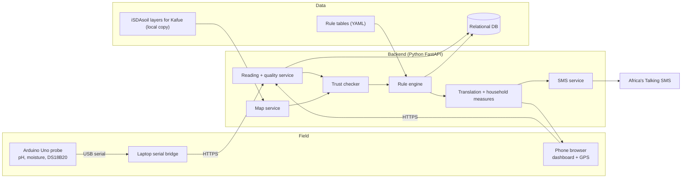

# SoilSense ZM: Implementation Spec (v0.3, 26 Oct 2026)

Changes in v0.3 (contracts changed while building Sprints 1 and 2): data model columns in 3, API in 4, REF-05 timing rule in 6.6, borderline-flag problem in 6.1 and 7.1 (C-9).

Changes in v0.2: first reviewer will not review scenarios or confirm tables (rule status model, 3 and 6); sorghum origin corrected (C-1); new conflicts C-7 lime lead time and C-8 target pH; REF-05 is per crop; about 30 new lab samples replace the earlier twelve (9).

Handoff document for coding agents (Claude Code, Antigravity).
Sources: dissertation Chapters 1 to 3 (v6) and the agronomist questionnaire v1 (returned Oct 2026).
Put this file at `docs/SOILSENSE_SPEC.md` in the repo. Companion file: `ANTIGRAVITY_AUDIT_PROMPT.md`.

---

## 0. Rules for agents (read first)

1. **This spec is the target; the existing code is not authoritative.** Audit the code against this spec before changing anything (see the audit prompt).
2. **Never invent agronomy values.** If a number is not in section 6, it is `OPEN`. Stub it, make the engine return "lab test recommended" for anything that depends on it, and add a failing-by-design test marked `xfail("OPEN: ...")`.
3. **Rules are data, not code** (NFR7). No lime rates, pH thresholds, crop names or fertiliser amounts in Python or JavaScript. They live in `rules/*.yaml`.
4. **Every piece of advice carries**: trust level, fired rule IDs, each rule's status (`verified` or `unreviewed`), and the pH method used. The UI must visibly label unreviewed rules and unreviewed translations.
5. **Test first** for the quality checker, trust checker and rule engine. Every rule ID has at least one test (NFR8).
6. **No machine learning anywhere.** Remove all ML code, models, training scripts and their dependencies.
7. **Secrets** (Africa's Talking key, DB passwords) never go in the repo. Phone numbers are stored only with consent and deleted after demonstrations (NFR5).
8. Small commits, one branch per track (section 8.4). Contract changes (DB schema, API, rule YAML shape, i18n keys) are made by editing this spec first, then the code.
9. When this spec and the code disagree, or the spec is ambiguous, write it down in `docs/MIGRATION_PLAN.md` under "Questions" instead of silently picking one.

### Status tags used in this document

| Tag | Meaning |
|---|---|
| `[DISS]` | Taken from the dissertation (Ch 1 to 3). Treat as the design decision. |
| `[AGR]` | From the agronomist questionnaire. **Expert opinion, no published source cited.** Store as `source_type: expert_opinion`. |
| `[PROPOSED]` | Engineering default suggested while writing this spec. Needs the developer's or agronomist's confirmation. Implement behind config, label as unreviewed. |
| `[OPEN]` | Unanswered or unclear. Do not implement a value. |
| `[CONFLICT]` | Two inputs disagree. Do not implement until resolved (section 7). |

---

## 1. What the system is

A rule-based soil and crop advisory system for smallholder farmers in Shimabala, Kafue District, Zambia `[DISS]`.

- A low-cost Arduino probe measures soil pH (moisture and temperature are used only to judge whether the pH reading can be trusted).
- The operator's phone supplies the field location.
- The system compares the measured pH with the free **iSDAsoil** 30 m map value at that spot. If they agree, it also uses the map's organic carbon, P, K and texture (moderate confidence). If not, it uses the measured pH plus simple field checks (low confidence) and says so.
- Output is three plans in English, Nyanja and Tonga with quantities in household measures:
  - **Plan A**: fix the soil and grow the target crop.
  - **Plan B**: cheaper or partial route.
  - **Plan C**: crops that suit the soil as it is.
- Crops: soybean, sunflower, maize, sorghum, millet `[DISS]`. See conflict C-1 (the agronomist's table has groundnut and no sorghum).
- Users: field operator (lead farmer or extension officer) is the main user; the farmer receives SMS on a basic phone; agronomist reviews rules; administrator manages users and devices.
- Primary interface is the web dashboard (phone browser, low bandwidth). SMS is for demonstration only.
- Out of scope: ML, weather forecasts (US13), market prices, other crops, government integrations, wireless probe-to-phone link.

---

## 2. Architecture `[DISS]`



Design choices to preserve: the map data is a **local copy** (no external service in the field); the laptop bridge is a prototype arrangement (wireless is future work).

### 2.1 Services and single responsibilities

| Service | Responsibility | Pure function? |
|---|---|---|
| `QualityChecker` | Accept or reject a reading (2.3) | Yes |
| `MapService` | Return iSDAsoil mean and SD for pH, plus OC, P, K, texture at a lat/lon | No (reads raster) |
| `TrustChecker` | Apply the agreement rule, assign trust level (2.4, 2.5) | Yes |
| `RuleEngine` | Load YAML rules, produce Plans A/B/C, record fired rules (section 6) | Yes (given `as_of_date`) |
| `Translator` | English, Nyanja (`ny`), Tonga (`toi`); flags unreviewed strings | Yes |
| `HouseholdMeasures` | Convert kg, g, litres to cups, tins, buckets | Yes |
| `SmsGateway` | Short summary to a consenting farmer via Africa's Talking | No |

### 2.2 End-to-end flow

1. Operator selects or registers a field. GPS fix worse than 30 m is rejected; operator may drop a manual pin, stored with `location_source = manual`.
2. Probe reading is taken (3 replicates) and the bridge posts it to the backend.
3. `QualityChecker` accepts or rejects. If rejected: trust = None, no advice, operator retakes or enters a lab pH.
4. `MapService` returns iSDAsoil values for the field location.
5. `TrustChecker` assigns the trust level.
6. If trust is Low, the dashboard asks for field checks (texture by feel, colour, waterlogging, previous crop, manure available).
7. Operator enters farm context: target crop, budget band, rainfed or irrigated, previous crop, manure available, past liming (optional).
8. `RuleEngine` returns Plans A/B/C plus fired rules. The advice request takes an `as_of_date` so tests are deterministic.
9. Translate, apply household measures, show in the dashboard, save everything.
10. Operator may send a short SMS.

### 2.3 Reading quality check `[DISS FR4]`

Reject unless all hold:

- Calibration is valid: pH 7.00 buffer sets offset, pH 4.00 buffer sets slope; slope must be **95% to 105%** of theoretical.
- Three replicate pH values lie within **0.1 pH** of each other.
- Suspension temperature (DS18B20) is inside the calibrated range (range value: config, `[PROPOSED]` default is the calibration temperature plus or minus 5 C, confirm).
- Moisture sensor flags waterlogged spots. Thresholds: `[OPEN]`, needs a two-point calibration of the capacitive sensor (air and water) on the actual hardware. `[AGR K4]` also says do not sample extremely dry, dusty soil or saturated soil.
- `[PROPOSED]` A pH outside 3.5 to 9.5 is treated as a probe fault (quality failure), not as soil.

### 2.4 Map agreement rule `[DISS]`

```
agree  <=>  |pH_probe - pH_map| <= T,   T = e_probe + s_map
```

- `e_probe` = largest absolute probe error against the lab (RQ1). **Provisional value 0.5** until validation (config `E_PROBE`).
- `s_map` = iSDAsoil standard deviation for that 30 m cell.
- Both values are pH in water, so no method conversion is needed for this comparison.
- `[PROPOSED]` Use the 0 to 20 cm layer to match the sampling depth. Verify layer scaling and units from the raster metadata when ingesting (do not assume natural pH units).

### 2.5 Trust levels `[DISS]`

| Level | Condition | Data used |
|---|---|---|
| High | Lab results entered | Lab values; full Plans A/B/C |
| Moderate | Reading passed; GPS within 30 m; map agrees | Measured pH plus map OC, P, K, texture; plans labelled "based on map estimates" |
| Low | Reading passed; map disagrees or has no value, or location is manual | Measured pH plus field checks; lime and crop suitability; lab test recommended before major spending |
| None | Reading failed quality check | No advice; retake or enter lab pH |

### 2.6 pH method handling (new, important)

Three different pH methods are in play and the rules must not mix them.

| Source | Method |
|---|---|
| Arduino probe | Water, approx 1:2.5 (field scoop and cup approximate the ratio) |
| iSDAsoil | Water |
| Zambian labs (UNZA, ZARI) | 0.01 M CaCl2, 1:2.5 `[AGR C2]`; water pH is 0.5 to 0.8 units higher than CaCl2 pH `[AGR C2, no source]` |
| Agronomist's bands and crop pH values | **`[OPEN]` not stated which method** |

Implementation:

- Add `ph_method` (`water` or `cacl2`) to `readings`, `map_estimates`, `lab_results`, and to every pH-dependent rule (`water`, `cacl2` or `unconfirmed`).
- `convert_ph(value, from, to)` uses config `PH_WATER_MINUS_CACL2 = [0.5, 0.8]` (a range, `[AGR]`, unsourced). It returns a low and a high value.
- For a rule with `ph_method: unconfirmed`, evaluate the farmer's pH under both readings (as-is, and converted using 0.5 and 0.8). If the resulting plan differs, mark the advice `method_sensitive` and replace quantities with "lab test recommended before buying lime" (show both outcomes to the operator).
- When the agronomist confirms the method, change `unconfirmed` to the real value in YAML. No code change.

---

## 3. Data model `[DISS]` plus proposed additions

| Table | Key fields | Notes |
|---|---|---|
| `users` | user_id, role (operator, agronomist, admin), password_hash | HTTPS, hashed passwords (NFR6) |
| `farmers` | farmer_id, alias, preferred_language (`en`, `ny`, `toi`), phone (nullable), sms_consent | Phone deleted after demos (NFR5) |
| `fields` | field_id, farmer_id, name, lat, lon, gps_accuracy_m, location_source (`gps`/`manual`) | `[PROPOSED]` optional `area_lima` for totals |
| `devices` | device_id, label | |
| `calibrations` `[PROPOSED]` | calibration_id, device_id, date, offset_mv, slope_pct, temp_c, accepted, reasons | Replaces slope/offset columns on `devices` so history is kept. Works in electrode mV; the bridge converts board volts to mV |
| `readings` | reading_id, field_id, device_id, operator_id, ph_water (mean, NULL if rejected), ph_method (`water`), replicates (JSON pH), replicates_mv (JSON, from the bridge), moisture, temp_c, quality_status, quality_reasons, calibration_id, ts | |
| `map_estimates` | estimate_id, field_id (unique), ph_mean, ph_sd, ph_method (`water`), oc, p, k, texture, depth_cm | Max one per field |
| `lab_results` | lab_id, field_id, ph, ph_method, soil_water_ratio, oc, p, k, texture, lab_name, date | Takes precedence over the map |
| `field_checks` | check_id, field_id, texture_by_feel, colour, waterlogging, previous_crop, manure_available | |
| `recommendations` | rec_id, reading_id (nullable when advice is from a lab result), field_id, trust_level, crop, budget_band, water, plan_a, plan_b, plan_c (JSON), result (full engine output, JSON), language, as_of_date, method_sensitive | |
| `rules` | rule_id, version, content_hash, domain, data (JSON), status, source_type, source_doc, reviewer_alias, ph_method, notes | Mirror of the YAML for audit; YAML is the source of truth. `data` replaces condition/action: the conditions live in the engine, the values in YAML. The version bumps when the YAML content changes |
| `recommendation_rules` | rec_id, rule_id, rule_version | Many-to-many; powers "why this advice" and records which version of each rule was used |
| `sms_messages` | sms_id, rec_id, status, ts | |

Rule `status`: `draft`, `agronomist_input`, `verified`. `source_type`: `published`, `expert_opinion`, `derived`, `proposed`.
Everything in section 6 starts as `agronomist_input` (for `[AGR]`) or `draft` (for `[PROPOSED]`). The first reviewer (anonymous) has said they will **not** confirm the written-back tables or review scenarios, so their answers can never move to `verified` on their own authority. A rule becomes `verified` only when a second qualified reviewer confirms it, or when it is matched to a cited published source (then `source_type: published`). `reviewer_alias` for the first reviewer is `AGR-1`; never store a name.

i18n: `i18n/en.yaml`, `i18n/ny.yaml`, `i18n/toi.yaml`. Each key has `text` and `reviewed: true|false`. Unreviewed text is shown with a visible marker (FR12).

---

## 4. API contract (as built, v0.3)

All endpoints except `/auth/login` and `/health` need a login token (`Authorization: Bearer ...`).

| Method and path | Purpose |
|---|---|
| `POST /auth/login`, `GET /auth/me` | Token for operator, agronomist, admin |
| `POST /users` | Admin only: create a user |
| `POST /farmers`, `GET /farmers`, `GET /farmers/{id}` | Farmer alias, language, optional phone (only with consent) |
| `DELETE /farmers/{id}/phone` | Remove phone and consent after a demonstration (NFR5) |
| `POST /fields`, `GET /fields/{id}`, `GET /fields/{id}/history` | Field registration with GPS, accuracy, source |
| `POST /devices` (admin), `GET /devices` | Register probes; list with latest calibration |
| `POST /devices/{id}/calibrations` | Body: mv_ph7, mv_ph4, temp_c (electrode mV). Returns accepted or rejected with slope % |
| `POST /readings` | Body: field_id, device_id, exactly one of replicates_mv (bridge; converted with the device's latest accepted calibration) or replicates_ph (operator), moisture, temp_c. A device with no accepted calibration gives a rejected reading |
| `GET /readings/{id}` | Reading with quality status and reasons |
| `GET /fields/{id}/map-estimate` | iSDAsoil values at the field |
| `POST /fields/{id}/checks` | Field checks (texture by feel etc.) |
| `POST /fields/{id}/lab-results` | Manual lab entry with method |
| `POST /advice` | Body: field_id, reading_id (optional when a lab result exists), crop, budget_band, water (`rainfed`/`irrigated`), previous_crop, manure_available, as_of_date (default today), lang. Returns trust, texture source, plans A/B/C, refusals, fired rules with status, method_sensitive and alternatives |
| `GET /advice/{rec_id}?lang=` | Re-render saved advice in another language |
| `POST /advice/{rec_id}/sms` | Send SMS summary (consent required) |
| `GET /rules` | Agronomist and admin: rules with provenance plus every OPEN and CONFLICT value. `PATCH /rules/{id}` is not built: rules are edited in `rules/*.yaml` (versions bump automatically). An in-app editor is a later decision |
| `GET /health` | Status check |

---

## 5. Requirements checklist (from Ch 3)

Must-have: FR1 login, FR2 field registration, FR3 reading capture, FR4 quality check, FR5 location capture, FR6 map lookup, FR7 agreement check, FR8 field checks, FR10 advice generation, FR11 household measures, FR12 translation, FR14 rule management.
Should-have: FR9 lab entry, FR13 SMS. Could-have: FR15 field history.
Non-functional (all must unless stated): NFR1 transparency, NFR2 never advise from a failed reading, NFR3 under 10 minutes per reading plus advice (should), NFR4 low bandwidth (should), NFR5 privacy, NFR6 security, NFR7 rules as data, NFR8 automated tests for every rule.

---

## 6. Rule data v0.1 (from the agronomist questionnaire)

All values below are `[AGR]` (reviewer `AGR-1`, anonymous, will not confirm) unless tagged otherwise. No published source was cited for any of them (G1 asked for a document name and none was given). Store as `source_type: expert_opinion`, `source_doc: null`, `status: agronomist_input`, `ph_method: unconfirmed`.

### 6.1 pH bands (`rules/ph_bands.yaml`)

The agronomist agreed with the draft bands (C1 = yes).

```yaml
ph_bands:                      # ph_method: unconfirmed  (see 2.6)
  - {id: severe,   lt: 4.5,                label: severely acidic}
  - {id: moderate, gte: 4.5, lt: 5.5,      label: moderately acidic}
  - {id: slight,   gte: 5.5, lte: 6.5,     label: slightly acidic}
  - {id: suitable, gt: 6.5,                label: suitable or near neutral}
# [PROPOSED] edge convention is as written above (lower bound inclusive).
# [PROPOSED] if |pH - band_edge| <= E_PROBE, flag the advice "borderline" and recommend a lab test.
# Problem found while building (C-9): with E_PROBE = 0.5 and edges 1 pH apart, every pH from 4.0
# to 7.0 is borderline, so the flag says nothing. Config BORDERLINE_MARGIN; decide a value.
```

Related answers: expected field pH around Kafue is 4.5 to 5.5 (C3); little or no fertiliser response below pH 4.5 (C4).

### 6.2 Crops (`rules/crops.yaml`)

```yaml
crops:
  maize:
    in_scope: true
    ph: {lowest_workable: 5.5, best: [5.5, 6.8], highest_workable: 7.5}
    acid_tolerance: low-medium
    planting_window_rainfed: [Nov, Dec]
    spacing_cm: [75, 25]
    basal: {product: "Compound D", rate_kg_ha: 200, note: "about 200 kg/ha (G1)"}
    top_dress:
      products: ["Urea (46% N)", "CAN"]
      splits_weeks_after_emergence: [[3, 4], [6, 8]]      # G1
      rate_kg_ha: OPEN
    manure_t_ha: [5, 15]
    acid_soil_problem: "poor root growth and nutrient availability"
    dry_season_irrigation: yes
    cautions: ["use a suitable seed variety"]              # D2
  soybean:
    in_scope: true
    ph: {lowest_workable: 5.5, best: [5.8, 7.0], highest_workable: 7.5}
    acid_tolerance: low
    planting_window_rainfed: [Nov, Dec]
    spacing_cm: [45, 5]
    basal: {product: "phosphorus-based fertiliser, according to soil test", rate_kg_ha: OPEN}
    top_dress: {product: "nil, or light ammonium nitrate", rate_kg_ha: OPEN}
    manure_t_ha: [5, 10]
    acid_soil_problem: "poor nodulation and phosphorus availability"
    dry_season_irrigation: "yes, with suitable management"
    cautions: ["inoculate with Bradyrhizobium japonicum, strongly, especially where soybean has not been grown recently (G3)"]
  sunflower:
    in_scope: true
    ph: {lowest_workable: 5.0, best: [6.0, 7.5], highest_workable: 8.5}
    acid_tolerance: medium
    planting_window_rainfed: [Dec, Jan]
    spacing_cm: [75, 30]
    basal: {product: "Compound D", rate_kg_ha: OPEN}
    top_dress: {product: "Urea or CAN, plus boron and potassium", rate_kg_ha: OPEN}
    manure_t_ha: [10, 20]
    acid_soil_problem: "poor root development and nutrient availability"
    dry_season_irrigation: "yes, with suitable management"
  millet:
    in_scope: true
    ph: {lowest_workable: 4.8, best: [5.5, 7.0], highest_workable: 7.5}
    acid_tolerance: medium-high
    planting_window_rainfed: [Nov, Dec]
    spacing_cm: [45, 10]
    basal: {product: "fertiliser (unspecified)", rate_kg_ha: OPEN}
    top_dress: {product: "Urea", rate_kg_ha: OPEN}
    manure_t_ha: [3, 5]
    acid_soil_problem: "tolerance varies by species and variety"
    dry_season_irrigation: "yes, with suitable management"
  groundnut:                                  # see conflict C-1
    in_scope: pending_supervisor_decision
    ph: {lowest_workable: 5.0, best: [5.8, 6.0], highest_workable: 7.5}   # best range looks like a typo, confirm
    acid_tolerance: medium
    planting_window_rainfed: [Nov, Dec]
    spacing_cm: [45, 10]
    basal: {product: "phosphorus-based fertiliser", rate_kg_ha: OPEN}
    top_dress: {product: "Gypsum", rate_kg_ha: OPEN}
    manure_t_ha: [5, 8]
    acid_soil_problem: "calcium availability"
    dry_season_irrigation: "yes, with suitable management"
  sorghum:
    in_scope: true                            # per Ch 1
    data: NONE                                # sorghum was not a column in questionnaire v1, so it was never asked (C-1)
```

Unit warning: manure is stored per hectare in **tonnes**. The agronomist wrote "lts/lima", but the numbers only match tonnes per lima (see C-5). Derive per-lima from per-hectare; do not use the per-lima text.

Not given for any crop: rotation role, typical yield (the maize yield answer in B7 has an unclear area basis, so do not use it).

Defaults: most smallholders are rainfed (B6: no dry-season irrigation locally). Irrigated is a secondary path.

### 6.3 Lime (`rules/lime.yaml`)

```yaml
lime:
  products: ["dolomitic lime", "calcitic lime"]      # E2; farmers buy in high-volume orders
  target_ph: [5.5, 6.5]                              # E3; G2 says 5.5-7, see C-8
  trigger_ph: OPEN                                   # E1 says "5.5-6.2"; see C-3
  rates_t_per_ha:                                    # E4, no source column filled
    severe:   {sandy: [1.0, 1.5], loamy: [2.0, 3.0], clay: [3.5, 5.0]}
    moderate: {sandy: [0.5, 1.0], loamy: [1.5, 2.0], clay: [2.5, 3.5]}
    slight:   {sandy: [0.0, 0.5], loamy: [0.5, 1.0], clay: [1.0, 1.5]}
    suitable: {sandy: [0, 0],     loamy: [0, 0],     clay: [0, 0]}
  max_single_application_t_ha: 5                     # E6 says "4 to 5"; confirm which
  texture_required: true                             # C6: texture must be known before lime advice
  lead_time_before_planting_months: CONFLICT         # E5 says 2-3 (rainfed; irrigated any time), E10 says 1-2; see C-7
  residual_effect_years: [3, 5]                      # E9
  retest_after_years: [2, 3]                         # E9
  partial_approach: CONFLICT                         # E7, see C-2
```

Local soils are mostly loamy and clay with some gravel (B3), so `sandy` will rarely be used, but keep it.

### 6.4 Fertiliser and organic inputs

- Official recommendation named by the agronomist: maize basal Compound D about 200 kg/ha, top dressing urea (46% N) or CAN in two splits (G1). **No document title given.**
- Soybean: strong inoculation requirement (G3). Groundnut and cowpea needs were not answered.
- Typical local practice: Compound D and urea mixed (B9); chicken manure becoming more common but whole-field application is the barrier; liming uncommon; ripping is normal (B8).
- Fertiliser advice when pH is low (G2): the agronomist said liming is generally recommended to bring pH to 5.5 to 7, but did not say whether to skip, reduce or still apply fertiliser. `[PROPOSED]` below pH 4.5 advise lime first and say fertiliser is unlikely to pay until the soil is limed (derived from C4).
- Section F (organic inputs, manure vs lime) was not answered.

### 6.5 Plan logic

**Plan A** (fix the soil, grow the target crop):
lime (rate from 6.3 by band and texture, clamped to the single-application cap, converted per lima) plus timing plus basal plus top dressing plus manure range plus crop cautions plus re-test advice.

**Plan B** (cheaper or partial route): **BLOCKED.** The only partial approach supplied (E7) is internally inconsistent (C-2) and the priority order for partial budgets (I2) was not answered. Budget bands the agronomist supports: low and medium (I1); there is no "higher" band yet. Until resolved, Plan B returns: "Partial plan not yet reviewed; start with Plan C crops and get a lab test."

**Plan C** (crops that suit the soil as it is):
`[AGR D1]` first preference is millet because of its acid tolerance. `[PROPOSED]` generate the rest by listing in-scope crops whose `lowest_workable` pH is at or below the farmer's pH (method-adjusted), ordered by lowest workable pH ascending (millet 4.8, then sunflower 5.0, then maize and soybean 5.5; groundnut 5.0 if confirmed in scope).

### 6.6 Always-include advice and refusals (`rules/messages.yaml`, `rules/refusals.yaml`)

| ID | Rule | Tag |
|---|---|---|
| MSG-01 | Re-test soil after 2 to 3 years; one lime application lasts 3 to 5 years | `[AGR E9]` |
| MSG-02 | Lime is not a substitute for fertiliser | `[AGR E11]` (common misunderstanding) |
| MSG-03 | Never apply more lime than a soil test supports; over-liming reduces yield | `[AGR E8]` |
| MSG-04 | Apply lime early and work it in; it needs moisture and time to react | `[AGR E10]` |
| MSG-05 | Soybean: inoculate with the right rhizobia | `[AGR G3]` |
| MSG-06 | Maize: use a suitable seed variety | `[AGR D2]` |
| MSG-07 | Common fertiliser mistakes: too early, too late, ignoring the weather | `[AGR G4]` |
| MSG-08 | Decision support only; consult an extension officer or lab before major spending | `[DISS]` |
| REF-01 | Reading failed quality check: no advice | `[DISS]` |
| REF-02 | pH below 4.5: no plan, refer to lab or extension officer | `[PROPOSED]`, anchored on C4 (no fertiliser response below 4.5) and the crop table (no crop workable below 4.8). C5 was left blank, so confirm. |
| REF-03 | Lime quantity requested but texture unknown (not from field check, lab or trusted map): no lime quantity, ask for texture by feel | `[AGR C6]` plus `[PROPOSED]` enforcement |
| REF-04 | pH above the crop's highest workable value: no lime, warn, recommend lab test | `[PROPOSED]`, derived from 6.2 |
| REF-05 | Lime lead time longer than the time left before **that crop's** planting window: say it is too late to lime for this season, give Plan C for this season and lime-for-next-season guidance | `[AGR E5, E10]` plus `[PROPOSED]` logic, uses `as_of_date`, per crop. Lead time is the range of the candidate answers (1 to 3 months, C-7). **Too late** if even the last day of the planting window is less than the shortest lead time away; **ok** if the first day of the window is at least the longest lead time away; otherwise **timing uncertain** ("liming now only works if you plant late in the window; consult an extension officer"). On 25 Oct: maize (Nov-Dec) and sunflower (Dec-Jan) are uncertain, not too late, because a late-December or January planting is still 2 to 3 months away; on 15 Dec maize is too late. Irrigated: any time |
| REF-06 | `method_sensitive` advice: no quantities, lab test recommended | `[PROPOSED]` (2.6) |
| REF-07 | Lime total above the single-application cap: split into applications, say so | `[AGR E6]`, split guidance `[OPEN]` |

`[PROPOSED]` design change to consider: always ask for texture by feel, not only when trust is Low, because lime quantity cannot be given without texture (C6) and map texture is a weak estimate.

### 6.7 Sampling guide for the dashboard help screen `[AGR K1 to K4]`

- Divide the field into areas that look alike (soil colour, texture, slope, drainage, crop growth, management). One composite sample per area, made from 15 to 20 subsamples taken at different points and mixed in a clean plastic bucket.
- Sample before planting. Do not sample right after fertiliser or manure.
- Avoid extremely dry, dusty soil; avoid saturated or standing-water soil; wait for moderate moisture, not straight after heavy rain.
- Sampling depth: `[OPEN]` (`[PROPOSED]` 0 to 20 cm to match the iSDAsoil layer).
- Reference labs named: ZARI Mount Makulu; University of Zambia, Soil Science (Land Management). No contacts or prices supplied.

### 6.8 Household measures (`rules/measures.yaml`)

`[OPEN]`. Section H was not answered. The developer will weigh cups, tins and buckets personally (see task H3). Until then the file is empty and the engine prints kg, g or litres with a "household measure not yet available" note.
`[PROPOSED]` working assumption: 1 lima = 0.25 ha (2,500 m2); confirm (H1 unanswered).

---

## 7. Open items and conflicts

### 7.1 Conflicts to resolve before coding the affected rule

| ID | Issue | Why it matters | Temporary behaviour |
|---|---|---|---|
| C-1 | **Crop scope.** Ch 1 says soybean, sunflower, maize, sorghum, millet. Questionnaire v1 itself offered maize, soybean, groundnut, sunflower, millet and sweet potato, so sorghum was never asked; the reviewer did not drop it. | Scope, objectives and tests all name five crops | Implement maize, soybean, sunflower, millet. Groundnut stored as `pending_supervisor_decision`. Sorghum stubbed `data: NONE` |
| C-2 | **E7 lime-at-planting numbers disagree.** "50 to 100 g per planting basin" vs "approx 200 to 400 kg/ha". At the maize spacing in the same table (75 x 25 cm = 53,333 stations/ha), 50 to 100 g per station is 2.7 to 5.3 t/ha, which is the full rate, not a partial one. 200 to 400 kg/ha would be roughly 4 to 8 g per station. | Plan B lime rate could be off by about 10 times | Plan B blocked |
| C-3 | **E1 lime trigger "5.5 to 6.2"** vs target pH 5.5 to 6.5 (E3) and E4 rates for 5.5 to 6.5. Is lime recommended when pH is below 5.5, or below 6.2? | Decides whether slightly acidic fields get lime at all | `trigger_ph: OPEN`; pH 5.5 to 6.5 shows "optional, small rate, lab test" |
| C-4 | **pH method** for the bands and crop table is not stated (labs use CaCl2, probe and map use water, difference 0.5 to 0.8). | Shifts every band decision by up to a full band | `ph_method: unconfirmed` plus method-sensitivity rule (2.6) |
| C-5 | **Manure unit.** "lts/lima" in the table only works as tonnes per lima (e.g. 5 to 10 t/ha equals 1.25 to 2.5 t/lima). Maize (written 1.25 to 5, computed 1.25 to 3.75) and groundnut (written 1.25 to 2.5, computed 1.25 to 2.0) do not match. | A litres reading would be about 1000 times out | Store per hectare in tonnes; derive per lima |
| C-7 | **Lime lead time.** E5: 2 to 3 months before planting (rainfed). E10: at least 1 to 2 months before planting. | Drives REF-05 (too late to lime this season) | Evaluate with both; flag when they differ (REF-05) |
| C-8 | **Target pH.** E3: 5.5 to 6.5. G2: 5.5 to 7. | Plan A target and the over-liming warning | Use 5.5 to 6.5 (narrower, safer against over-liming) |
| C-9 | **Borderline flag** `[PROPOSED]`: margin E_PROBE (0.5) around band edges 1 pH apart flags every pH from 4.0 to 7.0. | The flag carries no information | Implemented behind `BORDERLINE_MARGIN`; decide a smaller margin or drop the flag |
| C-6 | **Maize "lowest workable pH" (5.5) equals the bottom of its best range (5.5 to 6.8).** Same for soybean at 5.5 vs 5.8. Unclear if "lowest workable" means yield-limiting or just "below this, do not recommend". | Plan A vs Plan C boundary | Treat as "below this, not recommended without liming" |

### 7.2 Unanswered questionnaire items

| Section | Status | Consequence |
|---|---|---|
| A (about the reviewer) | A2 partly, A6 = No, A7 = not a family member; A1, A3 to A5 blank. Later: will not review scenarios or confirm tables | Reviewer cannot be named (alias `AGR-1`). Credentials unclear ("NRDC lecture and student"). Second reviewer approached, reply awaited |
| B | B1 blank, rest answered | Rainfall and agro-ecological region missing |
| C | C1 to C4, C6 answered; **C5 blank** | Refusal threshold unconfirmed (REF-02) |
| D | Table partly filled; rotation, yield, source rows blank; sorghum missing | Rates for most crops missing |
| E | All answered, with C-2 and C-3 | Plan B blocked |
| F | **Blank** | No organic-input rules beyond manure t/ha |
| G | G1 to G4 answered, no document named | Top-dressing rates missing; groundnut and cowpea needs missing |
| H | **Blank** | No household measures (developer measures them) |
| I | Prices blank; I1 = "medium to low"; **I2 blank** | Plan B priority order missing; prices are the developer's task |
| J | **Blank** | Rainfed vs irrigated advice differences only from E5 |
| K | K1 to K5 answered (depth missing) | Enough for the sampling guide |
| L | **Blank** | No tone or wording guidance; no extra safety cases |
| M | M3 = yes (pictures or voice help); M1 and M2 blank | No Nyanja or Tonga terms, no native reviewers |
| N | **Blank** | No source list. First reviewer will not review scenarios, so RQ3 depends on the second reviewer. Fallback if none by the deadline: redefine RQ3 (see 11) |

### 7.3 Follow-up questions

**To AGR-1 (clarification only; will not review or confirm):** see `docs/QUESTIONS_FOR_REVIEWER_1.md`. Questions 1 to 5 block code (C-4, C-2, C-3, C-7, I2).

**To the second reviewer (if they reply):** the full questionnaire v1 with a sorghum column added; confirmation of the section 6 tables written back as a plain table; the 60 to 100 scenario review for RQ3 (N2, N3); whether they may be named (A6).

---

## 8. Build plan

### 8.1 What actually depends on the lab results

Lab results are needed for **evaluation and for finalising two constants**, not for building:

| Needs lab results | Does not |
|---|---|
| RQ1 final probe error, so `E_PROBE` (provisional 0.5) | Backend, database, auth, field registration |
| RQ2 map vs lab comparison | Firmware, serial bridge, buffer calibration, quality checks |
| Probe validation against reference | Dashboard, GPS, i18n scaffolding |
| | Rule engine, rule schema, tests (on v0.1 data) |
| | Map ingestion and the trust checker |
| | Translation framework, SMS sandbox, household measures |

So the lab dispatch is the **critical path with an external dependency**: send samples first, then build in parallel.

### 8.2 Tasks that are not code (start now)

| ID | Task | Unblocks |
|---|---|---|
| H1 | Prepare and send samples to the lab (section 9) | RQ1, RQ2, `E_PROBE` |
| H2 | Send the follow-up questions in 7.3 to the agronomist | Plan A fertiliser, Plan B, refusals |
| H3 | Weigh cups, tins, 20 L buckets and 50 kg bags for lime, Compound D, urea, manure and seed; fill `rules/measures.yaml` | Household measures |
| H4 | Collect current prices with place and date (lime, Compound D, urea, seed, manure, transport) | Cost display (optional) |
| H5 | Find one native Nyanja and one native Tonga reviewer | FR12 reviewed strings |
| H6 | Download and clip iSDAsoil layers (pH mean and SD, OC, P, K, texture; 0 to 20 cm) for Kafue District. Script: `scripts/fetch_isdasoil.py` (raw values plus `layers.json` with each layer's back-transformation) | Map service |
| H7 | Decide crop scope with the supervisor (C-1) | Rule data |
| H8 | Confirm pH 4.00 and 7.00 buffers and the capacitive moisture sensor are on hand | Probe calibration |

### 8.3 Parallel tracks

| Track | Scope | Depends on | Blocked by lab? |
|---|---|---|---|
| **A. Backend foundation** | Remove ML; schema and migrations (section 3); auth and roles; farmer and field endpoints | Audit | No |
| **B. Hardware and bridge** | Arduino firmware (pH, moisture, DS18B20); serial bridge to `POST /readings`; two-buffer calibration; replicate and slope checks; moisture two-point calibration | Contract freeze | No (validation later: yes) |
| **C. Dashboard** | Mobile-first, low-bandwidth; login; field registration with phone GPS (30 m rule) and manual pin; reading screen; advice view shell; sampling help (6.7); i18n scaffolding | Contract freeze | No |
| **D. Rule engine** | YAML schema and validator; loader; evaluator; fired-rule trace; method-sensitivity logic; scenario test harness; load v0.1 data from section 6 | Contract freeze | No |
| **E. Map service** | Raster ingestion; lookup by lat/lon; agreement check (2.4) | H6 | No |
| **F. Language** | Glossary; en keys; draft ny and toi strings (all `reviewed: false`); unreviewed marker in UI | H5 for review only | No |
| **G. Delivery** | Household measures; SMS sandbox (Africa's Talking); consent and phone deletion | D, H3 | No |
| **H. Evaluation** | Probe vs lab; map vs lab; agronomist scenario review; farmer sessions with SUS | H1, H2, tracks A to G | Yes |

### 8.4 Which agent edits which folders (to avoid merge conflicts)

All the code belongs to the developer. This table only decides which AI tool works in which folders, so that two tools never edit the same files at the same time. The developer reviews and merges everything.

| Agent | Folders it edits |
|---|---|
| Antigravity (knows the existing code) | `backend/` (tracks A, E, G), `dashboard/` (track C) |
| Claude Code | `engine/`, `rules/`, `tests/`, `firmware/`, `bridge/`, `i18n/`, `scripts/` (tracks B, D, F; data preparation) |

`engine/` holds the pure logic: `quality.py`, `trust.py`, `rules.py`, `measures.py`. It has no FastAPI or database imports; `backend/` imports it and wraps it in endpoints.

Swap freely, but never have two agents editing the same folder at once. Shared contracts (schema, API, YAML shape, i18n keys) change only through this spec.

### 8.5 Sprint 0 (2 to 3 days): audit and contract freeze

1. Run the audit prompt; get `docs/MIGRATION_PLAN.md`.
2. Review it; decide what is kept, adapted, replaced, deleted.
3. Freeze four contracts: DB schema (section 3), API (section 4), rule YAML shape (section 6), i18n key format.
4. Create branches and apply the folder split above.

### 8.6 Sprint 1 (2 weeks)

**Must**

| # | Task | Done when |
|---|---|---|
| S1-1 | Remove all ML code and dependencies | App starts and tests pass with no ML imports; `grep -ri "sklearn\|tensorflow\|torch\|model.fit"` finds nothing |
| S1-2 | Schema and migrations for section 3 | Migration runs on an empty DB and on a copy of existing data; seed script creates one operator, one agronomist, one farmer, one field |
| S1-3 | Field registration with GPS (accuracy, source; reject over 30 m; manual pin) | API and dashboard create a field; a 45 m fix is rejected; a manual pin is stored as `manual` |
| S1-4 | Firmware, serial bridge, two-buffer calibration | A calibration with slope outside 95 to 105% is rejected; a good one is stored; bridge posts readings with 3 replicates |
| S1-5 | `QualityChecker` with tests | Tests cover slope 94/95/105/106%, replicate spread 0.10 vs 0.11, temperature out of range, implausible pH |

**Should**

| # | Task | Done when |
|---|---|---|
| S1-6 | Dashboard shell: login, language switch (en, ny, toi), field list, reading screen | Works on a basic phone browser over a slow connection |
| S1-7 | Rule YAML schema, validator and loader with section 6 data | Validator rejects a rule with no `source_type`; every `OPEN` value is surfaced in a report |

**Stretch**: iSDAsoil ingestion and `MapService` lookup (needs H6).

Sprint review: show the supervisor a field registered from a phone and a reading arriving from the probe through the bridge.

### 8.7 Later sprints (outline)

| Sprint | Goal |
|---|---|
| 2 | Map service, trust checker, field checks, rule engine core with Plan A and Plan C, scenario harness |
| 3 | Plan B (after C-2 and I2), household measures, refusals REF-01 to REF-07 |
| 4 | Translations with reviewed flags, SMS sandbox, advice view with "why this advice" panel |
| 5 | Evaluation: probe and map vs lab, agronomist scenario review, farmer usability sessions |

(The dissertation's Table 3.3 lists six sprints in a different order; update it once this plan is settled.)

---

## 9. Lab samples

Lab results feed RQ1 (probe accuracy) and RQ2 (map accuracy), so sample handling matters more than speed.

1. **Sampling** `[AGR K1 to K4]`: composite of 15 to 20 subsamples per similar area; before planting; not just after fertiliser or manure; not saturated or powder-dry. Depth `[PROPOSED]` 0 to 20 cm.
2. **Location**: record phone GPS (with accuracy) at the sampling spot at the time of sampling. This fixes the Ch 1 limitation that earlier sample locations were recorded afterwards.
3. **Labelling**: one sample ID per composite; keep a sheet of ID, farm alias, date, GPS, accuracy, depth, previous crop, recent manure or fertiliser.
4. **Prepare and split**: air-dry, sieve, mix, then split into two bags: one for the lab, one **retained** for the probe test (1:2.5 water, 3 replicates within 0.1) so probe and lab measure the same material.
5. **Ask the lab for**: pH in water at 1:2.5 **and** pH in 0.01 M CaCl2 at 1:2.5, with the method statement; plus organic carbon, P, K and texture if affordable (RQ2). Candidates named by the agronomist: ZARI Mount Makulu; UNZA Soil Science. Contacts and prices not supplied.
6. About 30 new composite samples **replace** the earlier twelve (decided). Ch 1 to 3 were updated to "about thirty" in v7; set the exact number once the samples are sent. The earlier twelve are not used for RQ1 or RQ2.

---

## 10. Test requirements

- **Quality checker**: boundary tests for slope, replicates, temperature, implausible pH.
- **Trust checker**: agree, disagree, no map value, manual location, GPS worse than 30 m, lab present, failed reading, `E_PROBE` change.
- **Rule engine**: each rule ID has a test; fired rules recorded; `OPEN` values return "lab test recommended".
- **Scenario suite** (feeds RQ3, target 80% agreement): 60 to 100 synthetic scenarios in a CSV (inputs plus engine output plus blank agronomist-recommendation column), labelled synthetic. Include: band edges (4.5, 5.5, 6.5), texture unknown, manual location, map disagrees, pH below 4.5, pH above crop maximum, method-sensitive cases, lime-too-late-for-this-season (set `as_of_date` in the test), budget low and medium, rainfed and irrigated.
- **Method sensitivity**: run the suite with `unconfirmed` read as water and as CaCl2; list scenarios whose plan changes.
- **No ML regression test**: CI fails if an ML library is imported.

---

## 11. Dissertation consistency notes

- Done in v7: the reviewer is described as anonymous, not related to the author, not confirming tables. Still pending (marked `% TODO` in the .tex): objective 3, RQ3 and its 80% target, Table 3.4 reviewer count, Ch 3 stakeholder wording. If no second reviewer by the agreed deadline, redefine RQ3 (for example review of a smaller scenario set by an extension officer or lecturer, or move expert agreement to future work).
- Crop list: Ch 1 scope (five crops with sorghum) vs the reviewer's table (groundnut, no sorghum).
- Done in v7: CaCl2 is now required in Ch 2 Table and Ch 3 section 3.5.1.
- Table 3.3 (sprints) should match the actual order once Sprint 0 is done.
- All `[AGR]` values are expert opinion without cited documents; the write-up must say so and not present them as published guidance.
